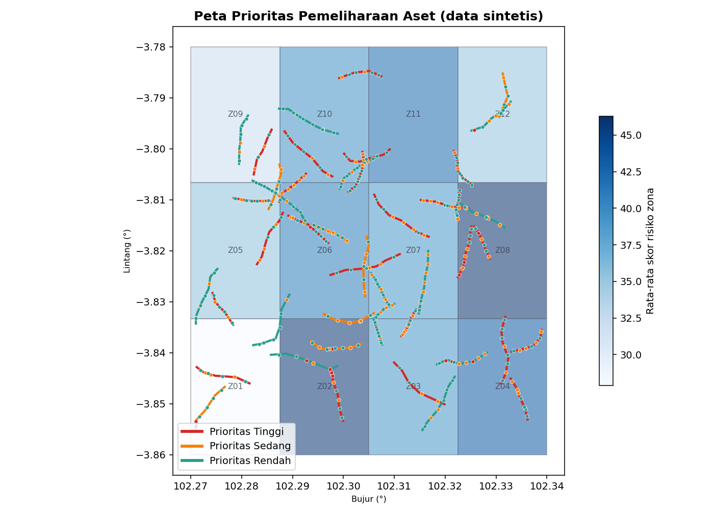
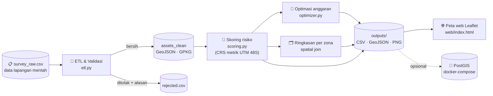
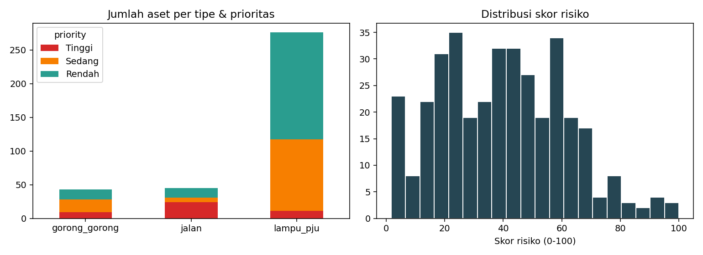

<div align="center">

# 🗺️ GeoAsset Priority

### Sistem Pendukung Keputusan Prioritas Pemeliharaan Aset Infrastruktur Kota berbasis GIS

*Dari data survei lapangan mentah → validasi otomatis → skor risiko → rencana perbaikan di bawah batas anggaran → peta web interaktif.*




</div>

---

## 📑 Daftar Isi

1. [Latar Belakang](#-latar-belakang)
2. [Studi Kasus](#-studi-kasus)
3. [Rumusan Masalah & Tujuan](#-rumusan-masalah--tujuan)
4. [Batasan Masalah](#-batasan-masalah)
5. [Arsitektur & Alur Data](#-arsitektur--alur-data)
6. [Struktur Proyek](#-struktur-proyek)
7. [Metodologi](#-metodologi)
8. [Hasil Eksekusi](#-hasil-eksekusi)
9. [Cara Menjalankan](#-cara-menjalankan)
10. [Memakai Data Sendiri](#-memakai-data-sendiri)

---

## 🎯 Latar Belakang

Proyek ini adalah **studi kasus penerapan materi** *"Peluang Karir dan Persaingan di Era Industri dengan Pemanfaatan GIS"* oleh **Widi Primadepa** (Asset Management GIS Analyst, City Care Property, Selandia Baru).

Materi tersebut menekankan lima gagasan. Setiap gagasan diterjemahkan menjadi fitur nyata di repositori ini:

| # | Gagasan dari materi | Diwujudkan di proyek ini |
|---|---|---|
| 1 | GIS adalah fondasi **keputusan strategis berbasis data**, bukan sekadar pemetaan | Model skor risiko + perencanaan anggaran, bukan hanya peta ([`scoring.py`](src/geoasset/scoring.py), [`optimizer.py`](src/geoasset/optimizer.py)) |
| 2 | Lulusan TI harus menjadi **developer** alat spasial (Python & JavaScript), bukan end-user | Seluruh pipeline ditulis dengan Python (GeoPandas) dan viewer web dengan JavaScript (Leaflet) |
| 3 | Pahami **workflow sistem secara holistik** agar AI/otomasi dapat dimanfaatkan | Pipeline end-to-end satu perintah; tiap tahap modular sehingga mudah diotomasi |
| 4 | Industri menuntut ekosistem **enterprise**: ArcGIS/QGIS, **FME**, **PostGIS**, cloud | ETL bergaya FME (validasi + saluran *rejected*), skema & kueri PostGIS, `docker-compose`, keluaran GeoPackage/GeoJSON yang bisa dibuka di QGIS/ArcGIS |
| 5 | Rekrutmen menilai **portofolio nyata**, pengalaman lapangan, dan komunikasi Inggris/dokumentasi | Repositori ini sendiri: kode teruji, CI, dokumentasi lengkap, data lapangan (simulasi) |

> 💡 **Mengapa manajemen aset?** Ini bidang kerja pemateri. Manajemen aset menggabungkan semua kompetensi di atas: data lapangan, basis data spasial, analisis, dan pelaporan ke pengambil keputusan.

---

## 🏙️ Studi Kasus

### Skenario

Sebuah pemerintah kota (fiktif) memiliki **ratusan aset infrastruktur** yang tersebar luas: ruas jalan, lampu penerangan jalan umum (PJU), dan gorong-gorong. Tim survei lapangan mengumpulkan data kondisi aset melalui formulir/aplikasi, lalu mengirimkan file CSV ke kantor pusat.

Masalah yang dihadapi manajer aset:

1. **Data lapangan kotor**: koordinat tertukar, ID ganda, skor di luar rentang, tahun pasang tidak masuk akal.
2. **Anggaran terbatas**: kebutuhan perbaikan jauh melebihi dana (pada simulasi ini, kebutuhan ±Rp 26,6 miliar vs anggaran Rp 2 miliar).
3. **Tidak ada dasar objektif** untuk menentukan *aset mana yang harus diperbaiki lebih dulu*.
4. **Sulit dikomunikasikan**: pimpinan butuh peta dan angka, bukan tumpukan spreadsheet.

### Solusi yang dibangun

Sebuah pipeline GIS yang secara otomatis: **membersihkan data → menghitung skor risiko tiap aset → merangkum per zona → memilih aset yang diperbaiki sesuai anggaran → menyajikan semuanya di peta interaktif**.

---

## ❓ Rumusan Masalah & Tujuan

**Rumusan masalah**

1. Bagaimana memvalidasi data survei lapangan secara otomatis dan transparan (tanpa membuang data secara diam-diam)?
2. Bagaimana mengukur tingkat risiko/urgensi tiap aset dengan memadukan **kondisi fisik, umur, dan kedekatan dengan fasilitas kritis** (rumah sakit, puskesmas, sekolah)?
3. Bagaimana memilih aset yang diperbaiki lebih dulu ketika **anggaran terbatas**?
4. Bagaimana menyajikan hasilnya agar mudah dipahami pengambil keputusan non-teknis?

**Tujuan**

- Membangun pipeline ETL spasial yang dapat direproduksi dengan satu perintah.
- Menghasilkan skor risiko 0–100 yang dapat dijelaskan (*explainable*) per aset.
- Menghasilkan daftar prioritas, ringkasan per zona, dan rencana perbaikan berbasis anggaran.
- Menyediakan peta web interaktif yang bisa dibuka tanpa server khusus.

---

## 🚧 Batasan Masalah

### Dalam cakupan ✅

| Aspek | Batasan |
|---|---|
| **Wilayah** | Area kajian persegi sekitar Kota Bengkulu: `102.27–102.34 BT`, `3.86–3.78 LS` (±7,7 × 8,9 km). Dipakai hanya sebagai konteks geografis |
| **Tipe aset dipelihara** | 3 tipe: **jalan** (garis), **lampu PJU** (titik), **gorong-gorong** (titik) |
| **Fasilitas kritis** | 3 jenis: rumah sakit, puskesmas, sekolah, hanya sebagai **faktor kritikalitas**, bukan objek perbaikan |
| **Data** | **Sintetis**, dibangkitkan dengan *seed* tetap (`2026`) sehingga reproducible. 401 baris mentah, 12 di antaranya sengaja dibuat salah |
| **Faktor risiko** | Hanya 3: kondisi (skor 1–5), umur terhadap umur layan, kedekatan dengan fasilitas kritis (radius 500 m) |
| **Pembagian zona** | Grid 4 × 3 = 12 zona (`Z01`–`Z12`) sebagai pengganti batas administrasi |
| **Optimasi anggaran** | Heuristik *greedy* berdasarkan rasio risiko/biaya, hanya untuk aset berkelas Sedang–Tinggi |
| **Keluaran** | CSV, GeoJSON, GeoPackage, PNG, dan peta web statis (Leaflet) |

### Di luar cakupan ❌

- Data aset **nyata** milik instansi mana pun. Ini bukan inventaris resmi.
- Jaringan topologi jalan (routing, lalu lintas, kepadatan kendaraan).
- Faktor risiko lain: curah hujan/banjir, kegempaan, nilai ekonomi, jumlah pengguna.
- Prediksi kerusakan (*machine learning*/*deterioration modelling*).
- Integrasi cloud produksi (Azure/AWS), autentikasi, dan sinkronisasi *real-time* dari aplikasi lapangan.
- Penyelesaian optimal global (*integer programming*) untuk pemilihan anggaran.

### Asumsi penting

- Skor kondisi: `1` = sangat baik … `5` = rusak berat.
- Biaya perbaikan (**asumsi**, bukan harga resmi): jalan Rp 450.000/m, lampu PJU Rp 6,5 juta/titik, gorong-gorong Rp 18 juta/titik.
- Umur layan rencana: jalan 15 th, lampu PJU 12 th, gorong-gorong 25 th.
- Tahun acuan analisis: **2026**.
- Bobot model (50/30/20) adalah **pilihan desain**, bukan standar baku. Semuanya dapat diubah di [`config.py`](src/geoasset/config.py).

---

## 🏗️ Arsitektur & Alur Data



**Prinsip desain**

- **Dua CRS dengan peran jelas**: `EPSG:4326` (WGS84) untuk penyimpanan & web; `EPSG:32748` (UTM 48S, satuan meter) untuk mengukur panjang jalan dan membuat *buffer* 500 m. Menghitung jarak dalam derajat adalah kesalahan klasik, dan di sini dihindari.
- **Tidak ada data hilang diam-diam**: baris yang gagal validasi masuk `rejected.csv` lengkap dengan alasannya (konsep saluran *rejected* di FME).
- **Konfigurasi terpisah dari logika**: bobot, ambang, biaya, dan umur layan ada di satu berkas.

---

## 📁 Struktur Proyek

```
geoasset-priority/
├── README.md
├── LICENSE
├── Makefile                     # make install | test | run | serve
├── requirements*.txt
├── docker-compose.yml           # PostGIS lokal (opsional)
├── .github/workflows/ci.yml     # CI: pytest + pipeline di Python 3.10 & 3.12
├── src/geoasset/
│   ├── config.py                # CRS, wilayah, bobot, biaya, ambang
│   ├── generate_data.py         # generator data survei sintetis (+ baris kotor)
│   ├── etl.py                   # parsing, normalisasi, validasi, deduplikasi
│   ├── scoring.py               # skor risiko, kritikalitas, agregasi zona
│   ├── optimizer.py             # seleksi aset di bawah anggaran
│   ├── report.py                # peta & grafik PNG
│   └── pipeline.py              # orkestrasi end-to-end (CLI)
├── tests/                       # 23 unit test (pytest)
├── data/
│   ├── raw/survey_raw.csv       # input mentah
│   └── processed/               # assets_clean.*, rejected.csv
├── outputs/                     # hasil analisis (CSV/GeoJSON/JSON)
├── web/
│   ├── index.html               # peta interaktif (Leaflet + JavaScript)
│   └── data.js                  # data hasil pipeline untuk peta
├── sql/                         # skema & contoh kueri PostGIS
├── scripts/                     # run_all.sh, load_to_postgis.py
└── docs/images/                 # gambar untuk README
```

---

## 🔬 Metodologi

### 1. Data & validasi (ETL)

Setiap baris data mentah melewati aturan berikut (urutan evaluasi):

| Aturan | Tindakan | Contoh kasus |
|---|---|---|
| Normalisasi tipe aset | **Diperbaiki** | `" Lampu PJU "` → `lampu_pju`, `Gorong-Gorong` → `gorong_gorong` |
| Geometri kosong | Ditolak | kolom WKT kosong |
| WKT tidak bisa di-parse / tidak valid | Ditolak | `POINT (abc def)` |
| Tipe aset tidak dikenal | Ditolak | `mobil` |
| Di luar wilayah studi | Ditolak | `POINT (-3.81 102.30)`: lat/lon tertukar |
| Skor kondisi di luar 1–5 | Ditolak | `9`, `0` |
| Tahun pasang di luar 1950–2026 | Ditolak | `2031`, `1890` |
| `asset_id` ganda | Ditolak (baris pertama dipertahankan) | input ganda |

### 2. Model skor risiko

Untuk setiap aset yang dipelihara:

$$\text{Risiko} = 100 \times w_{\text{tipe}} \times \big(0{,}50\,F_{\text{kondisi}} + 0{,}30\,F_{\text{umur}} + 0{,}20\,F_{\text{kritis}}\big)$$

| Komponen | Rumus | Rentang |
|---|---|---|
| `F_kondisi` | `(skor_kondisi − 1) / 4` | 0–1 |
| `F_umur` | `min(umur / umur_layan, 1)` | 0–1 |
| `F_kritis` | bobot fasilitas kritis tertinggi dalam radius **500 m** (RS = 1,0; puskesmas = 0,8; sekolah = 0,6; tidak ada = 0) | 0–1 |
| `w_tipe` | jalan 1,0 · gorong-gorong 0,85 · lampu PJU 0,7 | – |

> ⚠️ Karena `w_tipe < 1` untuk lampu PJU dan gorong-gorong, skor maksimum teoretisnya adalah **70** dan **85**; hanya jalan yang dapat mencapai 100. Ini disengaja: jalan dianggap lebih kritis.

**Kelas prioritas**: `Tinggi` ≥ 65 · `Sedang` 40–64,9 · `Rendah` < 40.

**Kritikalitas** dihitung dengan *buffer* + *spatial join* pada CRS metrik: fasilitas di-*buffer* 500 m, lalu aset yang beririsan dengan buffer mewarisi bobot fasilitas tertinggi.

### 3. Ringkasan per zona

Titik representatif tiap aset di-*spatial join* ke grid 12 zona untuk menghitung jumlah aset, rata-rata risiko, jumlah aset prioritas tinggi, dan total kebutuhan biaya. Aset yang tepat di garis batas zona tetap dihitung satu kali (bug ini ditemukan lewat unit test dan sudah diperbaiki).

### 4. Optimasi anggaran

Heuristik *greedy* 0/1-knapsack:

1. Ambil aset berkelas **Sedang–Tinggi** (skor ≥ 40).
2. Urutkan menurun berdasarkan `risiko ÷ biaya`.
3. Pilih berurutan selama total biaya ≤ anggaran.

---

## 📊 Hasil Eksekusi

> Angka di bawah berasal dari satu kali eksekusi dengan data sintetis dan anggaran default **Rp 2.000.000.000** (lihat [`outputs/summary.json`](outputs/summary.json)).

### Kualitas data

| | Jumlah |
|---|---:|
| Baris mentah | 401 |
| Lolos validasi | 389 *(364 aset dipelihara + 25 fasilitas kritis)* |
| Ditolak | 12 |

Alasan penolakan: ID ganda (3), tahun tidak wajar (2), di luar wilayah (2), kondisi di luar rentang (2), geometri kosong (2), WKT tidak valid (1).

### Prioritas aset

| Tipe | Tinggi | Sedang | Rendah | Total | Kebutuhan biaya |
|---|---:|---:|---:|---:|---:|
| Jalan | 24 | 7 | 14 | 45 | Rp 24,07 M |
| Gorong-gorong | 9 | 19 | 15 | 43 | Rp 0,77 M |
| Lampu PJU | 11 | 106 | 159 | 276 | Rp 1,79 M |
| **Semua** | **44** | **132** | **188** | **364** | **Rp 26,64 M** |

<div align="center">

</div>

### Zona paling berisiko

| Zona | Rata-rata risiko | Aset prioritas tinggi |
|---|---:|---:|
| **Z08** | 46,3 | 7 |
| **Z02** | 46,0 | 7 |
| Z04 | 43,3 | 4 |
| *Z01 (terendah)* | *27,9* | *2* |

### Rencana perbaikan (anggaran Rp 2 M)

- **147 aset** terpilih (117 lampu PJU, 28 gorong-gorong, **hanya 2 jalan**), total Rp 1,97 M.
- Rencana ini mencakup **79,2 %** dari total skor risiko aset berkelas Sedang–Tinggi.

### 🔍 Temuan & interpretasi (jujur)

1. **Jalan mendominasi kebutuhan** (±90 % biaya) dan memiliki skor risiko rata-rata tertinggi (59,5), namun hampir tidak tersentuh rencana anggaran.
2. **Ini bukan bug, melainkan sifat heuristik rasio risiko/biaya**: aset murah (lampu, gorong-gorong) selalu menang. Pada kenyataannya manajer aset mungkin ingin *menjamin* sebagian anggaran untuk aset kritis berprioritas Tinggi, apa pun biayanya.
3. Hasil ini menunjukkan bahwa **pilihan metode optimasi adalah keputusan kebijakan**, bukan sekadar teknis. Lihat [pengembangan lanjutan](#-keterbatasan--pengembangan-lanjutan) untuk alternatifnya.

---

## 🚀 Cara Menjalankan

### Prasyarat

- Python **3.10+**
- (Opsional) Docker, bila ingin mencoba PostGIS

### Langkah cepat

```bash
# 1. Salin / clone repositori
git clone https://github.com/<username-anda>/geoasset-priority.git
cd geoasset-priority

# 2. (disarankan) virtual environment
python -m venv .venv
source .venv/bin/activate          # Windows: .venv\Scripts\activate

# 3. Pasang dependensi
pip install -r requirements-dev.txt

# 4. Jalankan unit test
python -m pytest -q                # 23 passed

# 5. Jalankan pipeline end-to-end
cd src && python -m geoasset.pipeline --budget 2000000000 && cd ..

# 6. Buka peta interaktif
cd web && python -m http.server 8000
# lalu buka http://localhost:8000
```

Atau dengan `make`: `make install && make test && make run && make serve`.

### Opsi CLI

| Opsi | Fungsi |
|---|---|
| `--budget N` | Anggaran perbaikan dalam rupiah (default 2.000.000.000) |
| `--no-regenerate` | Pakai `data/raw/survey_raw.csv` yang ada (tidak dibangkitkan ulang) |

### Peta web

Peta menampilkan aset berwarna menurut prioritas, zona (*choropleth* sederhana), dan fasilitas kritis. Anda dapat menyaring berdasarkan kelas prioritas, tipe aset, dan skor minimum; mengklik aset memunculkan rincian (skor, kondisi, umur, biaya, apakah masuk rencana anggaran).

> Peta memuat pustaka Leaflet dan ubin OpenStreetMap dari internet, jadi koneksi internet diperlukan saat membukanya.

### PostGIS (opsional)

```bash
docker compose up -d                              # PostGIS + skema otomatis
pip install -r requirements-postgis.txt
python scripts/load_to_postgis.py                 # muat hasil analisis
# lalu coba kueri di sql/queries.sql
```

> ℹ️ Bagian PostGIS disertakan sebagai contoh integrasi basis data spasial. Pipeline utama dan 23 unit test sudah dijalankan dan lulus; **skrip PostGIS belum diuji terhadap server database dalam pembuatan paket ini**, jadi mungkin perlu penyesuaian kecil di lingkungan Anda.

### Membuka hasil di QGIS / ArcGIS

Drag-and-drop `outputs/assets_scored.geojson` atau `data/processed/assets_clean.gpkg` ke QGIS. CRS data adalah EPSG:4326.

---

## 🔁 Memakai Data Sendiri

Ganti `data/raw/survey_raw.csv` dengan data Anda (jalankan pipeline dengan `--no-regenerate`). Kolom yang dibutuhkan:

<details>
<summary><b>Kamus data (klik untuk membuka)</b></summary>

| Kolom | Tipe | Keterangan |
|---|---|---|
| `asset_id` | teks | ID unik aset |
| `asset_type` | teks | `jalan`, `lampu_pju`, `gorong_gorong`, `fasilitas_kritis` |
| `subtype` | teks | untuk fasilitas kritis: `rumah_sakit`, `puskesmas`, `sekolah` |
| `name` | teks | nama (opsional) |
| `wkt` | teks | geometri WKT dalam EPSG:4326, urutan `lon lat` |
| `condition` | angka 1–5 | 1 = sangat baik, 5 = rusak berat (kosong untuk fasilitas kritis) |
| `install_year` | angka | tahun pasang (kosong untuk fasilitas kritis) |
| `last_inspection` | teks | tanggal inspeksi terakhir |
| `surveyor` | teks | nama tim/surveyor |
| `notes` | teks | catatan |

Jangan lupa menyesuaikan `STUDY_BBOX` dan `CRS_METRIC` di [`config.py`](src/geoasset/config.py) dengan wilayah Anda (zona UTM berbeda tiap wilayah).

</details>

**Mengubah perilaku model**: edit [`config.py`](src/geoasset/config.py): bobot (`w_condition`, `w_age`, `w_criticality`), ambang prioritas, radius kritikalitas, umur layan, dan biaya satuan.

<div align="center">

**⭐ Jika bermanfaat, beri bintang pada repositori ini!**

</div>
